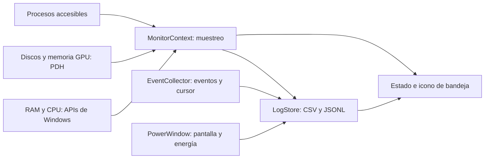

# Cómo funciona PCWatch

## Flujo del programa

`Program.Main` procesa las opciones y calcula un identificador a partir de la carpeta de datos. Un mutex impide dos instancias sobre la misma carpeta; una señal de Windows permite que `--stop` detenga solo ese monitor. El inicio automático añade un acceso directo a Inicio del usuario; está separado del arranque normal y se activa únicamente al solicitarlo.

El programa tiene un hilo de interfaz para el icono y los avisos de Windows, y un hilo de trabajo para recopilar datos. El muestreo espera entre ciclos y usa prioridad inferior a la normal. No entra en un bucle que ocupe la CPU continuamente.

## Medidas

`Native` llama a `GlobalMemoryStatusEx`, `GetPerformanceInfo` y `GetSystemTimes`. Son lecturas del estado del sistema: no inspeccionan la memoria de tus aplicaciones ni el contenido de tus archivos. La CPU se calcula comparando el tiempo ocupado con el tiempo total entre dos muestras. La primera lectura no tiene una muestra anterior y se deja vacía.

`Counters` abre una consulta PDH una sola vez y conserva los contadores. Usa nombres ingleses con `PdhAddEnglishCounter` para no depender del idioma del sistema. Las latencias se registran en milisegundos con valores decimales. La memoria gráfica agrega adaptadores; no mide temperatura ni carga de GPU.

El ranking de procesos se toma cada minuto. Guarda nombre, PID, memoria privada/Working Set y diferencia de tiempo de CPU; normaliza CPU al total de procesadores lógicos. Si no tiene permiso para leer un proceso, lo omite y lo indica como cobertura limitada. Las ventanas colgadas se consultan sin guardar su título ni enviar teclas/clics.

## Eventos y privacidad

`EventCollector` ejecuta consultas filtradas sobre System y Application. Usa proveedor e ID, no únicamente el número de evento: el mismo número puede significar cosas distintas en otro proveedor. Recupera inicialmente dos horas y después persiste el último `RecordId` procesado. Cada pasada tiene un máximo de 100 eventos por registro; si queda historial pendiente, continúa en la siguiente sin saltarlo.

El cursor avanza después de guardar el evento. Si la escritura falla, el evento queda pendiente. Si Windows reinicia un registro y los IDs disminuyen, se recupera una ventana reciente. Los errores de acceso se registran como falta de cobertura, sin elevar permisos.

El XML de un evento se procesa en memoria para seleccionar campos. No se conserva XML, mensaje completo ni RawData. Los nombres de ejecutables se reducen a su nombre base. CPER conserva solo severidad, flags, cantidad de secciones y GUIDs de tipos; no payloads, números de serie ni identificadores únicos del registro. Las pruebas de privacidad usan marcadores sintéticos, no credenciales reales.

`PowerWindow` permanece invisible y recibe avisos de pantalla y energía. Esto ayuda a diferenciar “se apagó el monitor” de una suspensión real. Un hueco de muestras conserva su duración con causa desconocida; por sí solo no demuestra un congelamiento.

## Almacenamiento y fallos

`LogStore` escribe formatos abiertos, rota por fecha UTC/tamaño y limpia únicamente nombres propios reconocidos dentro de Logs. Rechaza que Logs sea un enlace/junction. La retención tiene un tope de tamaño, para no convertir el diagnóstico en otro problema de disco.

El estado conserva la hora de la última muestra escrita con éxito. Un fallo de almacenamiento queda visible aunque sea imposible escribir el aviso en el mismo disco. La interfaz no presenta datos antiguos como si fueran una medición nueva. Los fallos se recuperan por componente: guardar un archivo de actividad no oculta que el archivo de recursos sigue bloqueado.

## Por qué C# y no Python

Python también puede implementar un monitor ligero. Para un registrador de consola, `ctypes` permite llamar a APIs de Windows, y puede consumir poca RAM. El lenguaje por sí solo no determina el consumo: importan las bibliotecas, la frecuencia de consultas y la interfaz.

C# permitió reunir bandeja, avisos de energía, PDH, WMI y lectura de eventos con bibliotecas de Windows/.NET, sin instalar paquetes. El ejecutable usa .NET Framework disponible en Windows; no necesita distribuir un intérprete Python ni un runtime independiente. Fue una decisión de integración y distribución, no una afirmación de que C# siempre sea más rápido o ligero.

El compromiso es que el programa se limita a Windows x64 y usa .NET Framework, una plataforma estable ligada a Windows. Para una futura aplicación multiplataforma habría que reconsiderar APIs y runtime; para el núcleo de un script personal, Python seguiría siendo razonable.

Referencias primarias: [APIs de interoperabilidad de .NET](https://learn.microsoft.com/en-us/dotnet/standard/native-interop/pinvoke), [.NET Framework en Windows](https://learn.microsoft.com/en-us/dotnet/framework/install/versions-and-dependencies), [contadores de Windows](https://learn.microsoft.com/en-us/windows/win32/perfctrs/about-performance-counters), [consultas de eventos](https://learn.microsoft.com/en-us/windows/win32/wes/consuming-events).
