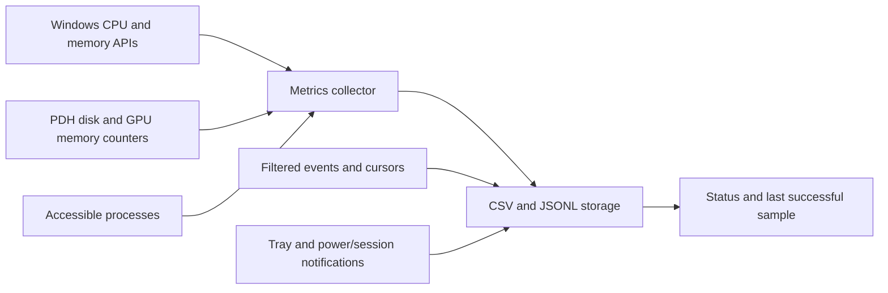

# How PCWatch works

## Program flow

`app.py` parses options, opens the data folder and coordinates collection. A named Windows mutex prevents two instances from writing into the same folder. A named event lets `--stop` signal that instance. Automatic startup is a separate, explicitly requested operation in `startup.py` that adds a shortcut to the current user's Startup folder through native Windows COM APIs.

The interface receives native Windows messages for the notification-area icon and power/session changes. Collection runs on a worker thread, waiting between passes rather than continually polling. The process uses below-normal priority so measurements are less likely to compete with foreground applications.

## Measurements

`metrics.py` calls `GlobalMemoryStatusEx`, `GetPerformanceInfo` and `GetSystemTimes` using Python's standard-library `ctypes` module. These APIs provide system statistics; PCWatch does not read the contents of application memory. CPU usage is the change in busy time divided by the change in total time. The first observation has no previous sample, so its CPU value is unavailable.

A persistent PDH query avoids opening every counter on each sample. English counter names are added using `PdhAddEnglishCounterW`, independently of the display language of Windows. Disk latency is converted to milliseconds. Dedicated and shared GPU memory are aggregated across the available counters; these values do not describe GPU load or temperature.

Process collection stores executable name, PID, private memory, working set and the change in CPU time, normalized across the logical processors. Inaccessible processes are excluded and counted as limited coverage. Hung-window detection uses Windows' response-state information without collecting window titles or sending input.

## Events and privacy

`events.py` queries the System and Application logs using the Windows Event Log API. Filters match both provider and event ID because the same event ID can have different meanings across providers. The first pass covers a recent two-hour window. Later passes continue from the persisted record ID, with bounded work per log per pass.

The cursor advances after an event is saved. If storage fails, the event remains pending for a later attempt. If a log is cleared and record IDs fall, collection returns to a recent window. Access errors indicate missing coverage; the program does not elevate permissions or alter log access controls.

Event XML is processed in memory to select allowlisted technical fields. Full messages, XML and raw event payloads are not stored. Executable fields are reduced to their base name. CPER parsing retains header metadata and section-type GUIDs, excluding raw payloads and unique record identifiers. Tests exercise this policy with synthetic markers rather than real credentials.

Windows display, suspend/resume and session lock/unlock notifications make it possible to distinguish some changes in display state from actual system sleep. A sampling gap is recorded with its duration and unknown cause. It cannot independently prove a freeze or identify a defective component.

## Storage and recovery

`storage.py` writes open CSV and JSONL formats. Segments rotate by UTC date and size. Cleanup acts only on recognized PCWatch log filenames inside the selected Logs folder and rejects a Logs folder that is a link or junction. Retention is limited by both age and total size.

Each write is flushed. Atomic replacement is used for status/state files so readers do not normally observe half-written JSON. A storage error remains visible through status when that status file can be written. The last successful resource-sample timestamp is only updated after the sample is stored.

Component-specific health prevents a successful activity write from hiding a resource-log failure. When storage becomes available again, recording resumes. A shutdown or disk failure can still lose recent records; these mechanisms reduce that risk without promising crash-proof storage.

## Why Python

Python provides a readable implementation with CSV, JSON, XML parsing, threading, command-line handling and native interoperability in its standard library. `ctypes` calls the Windows APIs directly, so the monitor does not need `psutil`, a web framework, a background PowerShell process or any package downloads.

The cost is distribution: users need a suitable Python installation, and the ZIP contains source rather than a standalone executable. `pythonw.exe` runs the tray application without a console window. The command-line entry point remains useful for short recordings and tests.

The language alone does not determine overhead. Collection frequency, selected APIs, process count and additional libraries matter. Keeping the monitor local, infrequent and free of third-party dependencies is the main design choice. The APIs used here are Windows-specific, so changing the language does not make the application cross-platform.

Primary API references: [Python ctypes](https://docs.python.org/3/library/ctypes.html), [Windows performance counters](https://learn.microsoft.com/en-us/windows/win32/perfctrs/about-performance-counters), [Windows Event Log consumption](https://learn.microsoft.com/en-us/windows/win32/wes/consuming-events), and [GlobalMemoryStatusEx](https://learn.microsoft.com/en-us/windows/win32/api/sysinfoapi/nf-sysinfoapi-globalmemorystatusex).
